AWS Two-Server Monitoring & Observability Platform

A DevOps portfolio project that deploys a Python Flask application on AWS EC2 and monitors it with a full observability stack: Prometheus, Grafana, Loki, Jaeger, Node Exporter, cAdvisor and Grafana Alloy, running on a separate monitoring server.

Architecture Diagram

Table of Contents
Project Overview
Architecture
Technologies Used
What I Implemented
Setup Guide
Screenshots & Results
Key Learnings
Future Improvements
Project Overview

The project uses two separate AWS EC2 instances: one runs the application, the other runs the monitoring stack. The goal is to monitor application and infrastructure performance, centralize logs, visualize resource usage, and explore distributed tracing.

Keeping monitoring on its own server means that if the application server fails or is overloaded, the monitoring system stays up and can still show what went wrong.

Architecture
EC2 Instance 1: Application Server
Python Flask web application (Docker container)
Node Exporter: host-level metrics (CPU, memory, disk, network)
cAdvisor: Docker container metrics
Grafana Alloy: collects and forwards telemetry (metrics and logs)
EC2 Instance 2: Monitoring Server
Prometheus: metrics collection and storage
Grafana: dashboards and visualization
Loki: centralized log aggregation
Jaeger: distributed tracing UI

Data flow: Node Exporter and cAdvisor expose metrics, which Prometheus scrapes from the app server. Alloy ships logs to Loki. Grafana connects to Prometheus, Loki and Jaeger as data sources and visualizes everything in one place.

Technologies Used
Technology	Purpose
AWS EC2	Hosts the two separate servers
Docker / Docker Compose	Containerizes the Flask app and monitoring services
Python Flask	Web application (login and task pages)
Node Exporter	Host-level metrics
cAdvisor	Container-level metrics
Grafana Alloy	Telemetry collection and forwarding
Prometheus	Metrics collection and querying
Grafana	Dashboards and visualization
Loki	Centralized log storage and querying
Jaeger	Distributed tracing interface
Linux / Ubuntu	Server administration
What I Implemented
Deployed a Flask application with login and task-related pages
Created separate application and monitoring EC2 instances
Configured Docker-based application and monitoring services
Configured Prometheus scrape targets
Connected Prometheus, Loki and Jaeger as Grafana data sources
Built Grafana dashboards for CPU, memory and container metrics
Set up centralized log visualization with Loki
Explored Jaeger for distributed tracing
Generated application traffic and observed the changes on the dashboards
Setup Guide

Adjust IPs, ports and file paths to match your own configuration.

1. Launch two EC2 instances
Ubuntu instances, one for the app server and one for the monitoring server
Configure security groups so the monitoring server can reach the app server's exporter ports
Service	Default Port
Flask app	5000
Node Exporter	9100
cAdvisor	8080
Prometheus	9090
Grafana	3000
Loki	3100
Jaeger UI	16686
2. Install Docker on both servers
bash
sudo apt update
sudo apt install -y docker.io docker-compose
sudo systemctl enable --now docker
3. App server
bash
git clone <your-repo-url>
cd observability-project
docker-compose up -d

This starts the Flask app, Node Exporter, cAdvisor and Grafana Alloy.

4. Monitoring server
bash
docker-compose up -d

This starts Prometheus, Grafana, Loki and Jaeger. In prometheus.yml, add the app server's private IP as a scrape target for Node Exporter and cAdvisor.

5. Configure Grafana
Open http://<monitoring-server-ip>:3000
Add Prometheus, Loki and Jaeger as data sources
Build dashboards for CPU, memory, container metrics and logs
Screenshots & Results
1. Infrastructure & Application
<table> <tr> <td width="50%" align="center">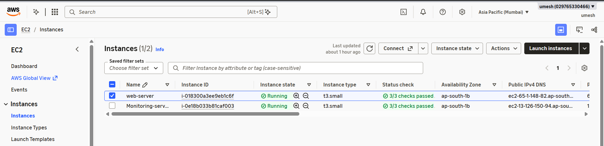 <b>AWS EC2 Servers</b> Application server and monitoring server running</td> <td width="50%" align="center">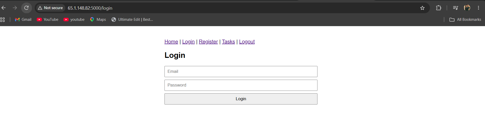 <b>Flask Application</b> Login page served from the app server</td> </tr> </table>
2. Metrics Collection
<table> <tr> <td width="50%" align="center">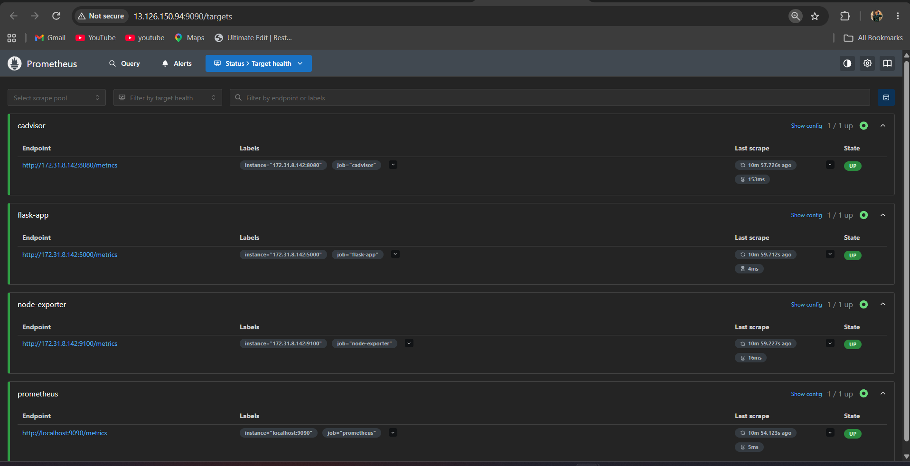 <b>Prometheus Targets: UP</b> All scrape targets healthy</td> <td width="50%" align="center">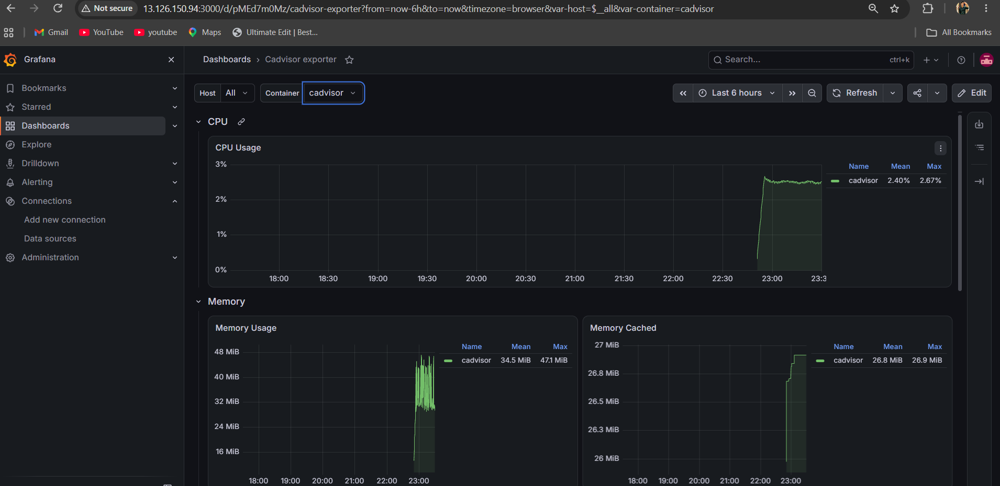 <b>cAdvisor</b> Per-container resource usage</td> </tr> </table>
3. Grafana Dashboards
<table> <tr> <td width="50%" align="center">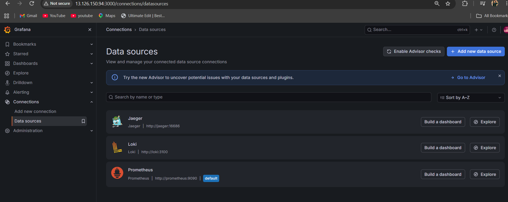 <b>Data Sources</b> Prometheus, Loki and Jaeger connected</td> <td width="50%" align="center">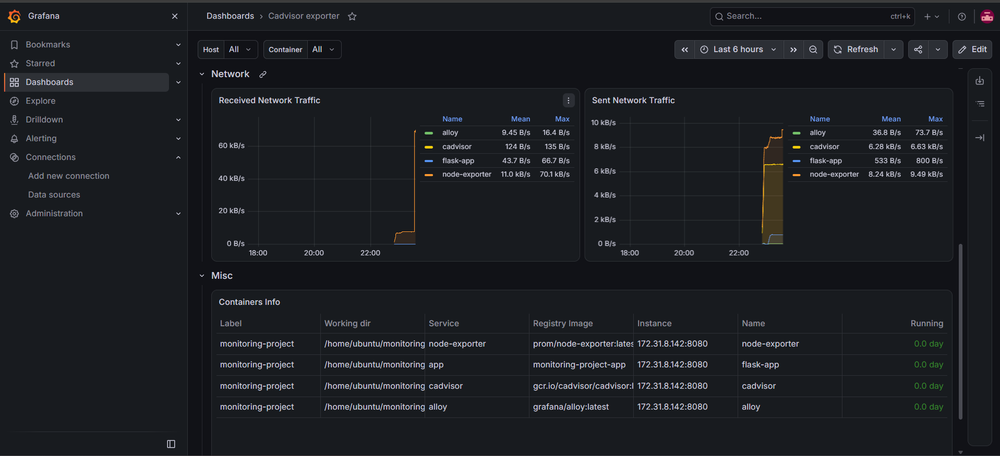 <b>Overall Monitoring</b> CPU and memory across the infrastructure</td> </tr> </table> 
 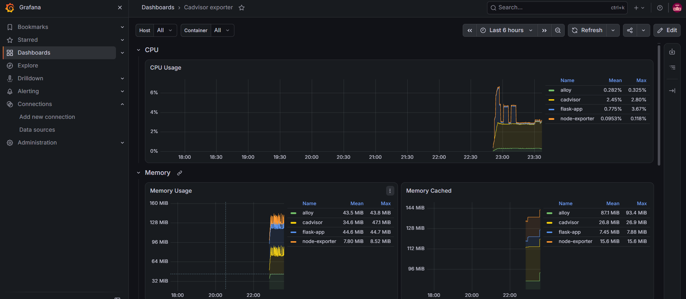  <b>Node Exporter, Flask, cAdvisor & Alloy Dashboard</b>  Combined view of host, application, container and collector metrics 

4. Logs & Tracing
<table> <tr> <td width="50%" align="center">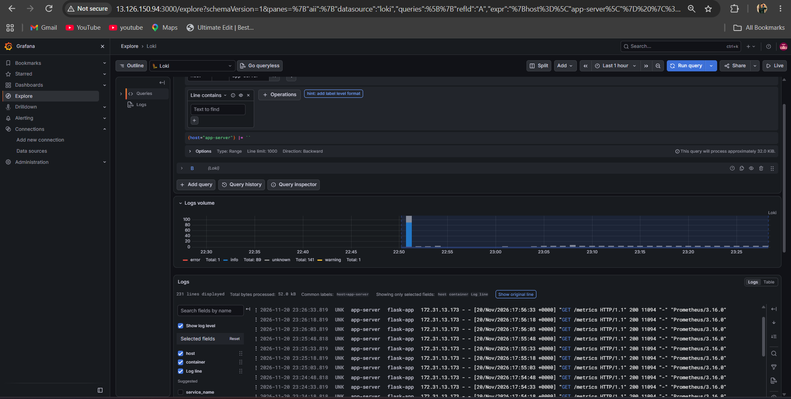 <b>Loki Log Dashboard</b> Centralized application logs in Grafana</td> <td width="50%" align="center">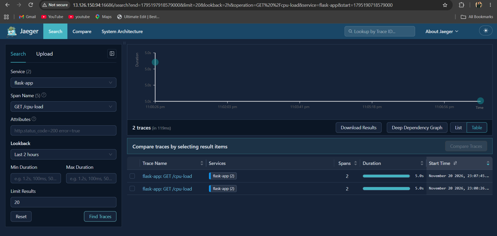 <b>Jaeger UI</b> Distributed tracing interface</td> </tr> </table>
5. Before vs After Traffic

Traffic was generated against the app to show how the dashboards react.

<table> <tr> <td width="50%" align="center">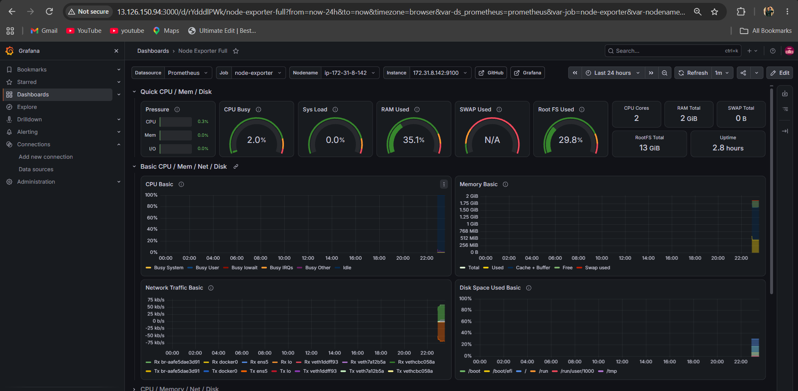 <b>Before Traffic</b></td> <td width="50%" align="center">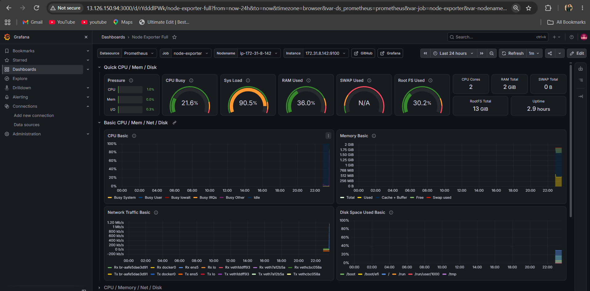 <b>After Traffic</b></td> </tr> </table> 
 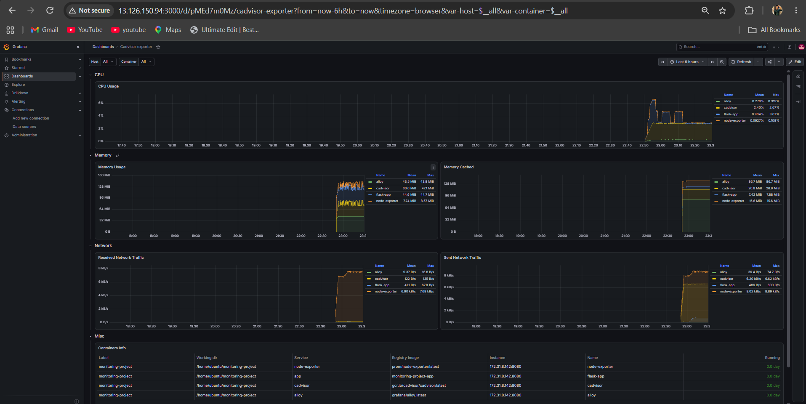  <b>Baseline Chart</b>  Resource usage before load was applied 

6. Version Control

 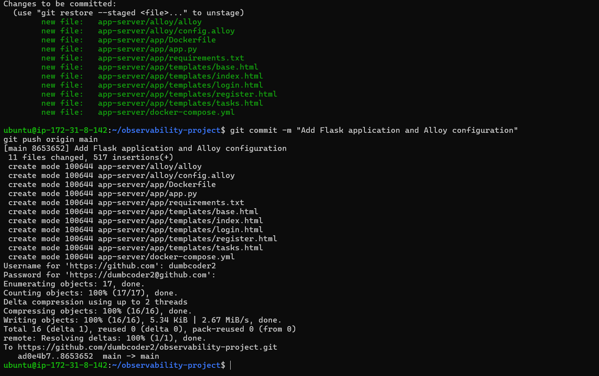  <b>Git Push</b>  Project files pushed to GitHub 

Key Learnings
Why two EC2 instances? Separating the monitoring server from the app server means monitoring survives app failures and doesn't compete with the app for resources.
Prometheus vs Grafana: Prometheus collects and stores metrics; Grafana visualizes data from Prometheus and other sources.
Node Exporter vs cAdvisor: Node Exporter reports host/OS metrics; cAdvisor reports per-container metrics.
Grafana Alloy: A collector that gathers telemetry from the app server and forwards it to the monitoring backends.
Loki: Stores and indexes logs by labels, and is queried from Grafana using LogQL.
Jaeger: Visualizes distributed traces, showing how a request flows through services and where time is spent.
Docker Compose: Defines multiple services in one file and connects them over a shared network.
Future Improvements
Add Prometheus alerting rules with Alertmanager (email/Slack)
Full application instrumentation with OpenTelemetry for end-to-end tracing
Provision infrastructure with Terraform
Add a CI/CD pipeline for automated deployment
Secure Grafana and Prometheus with HTTPS and authentication
Author

Nikhil